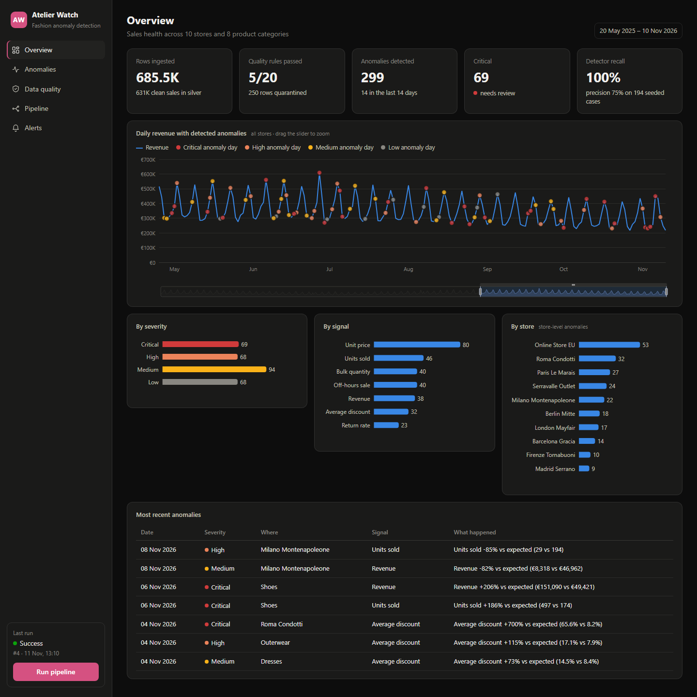
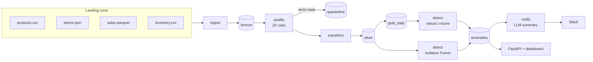
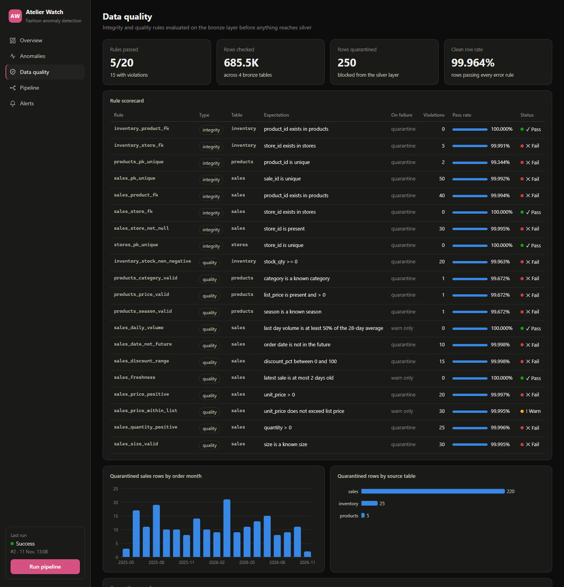
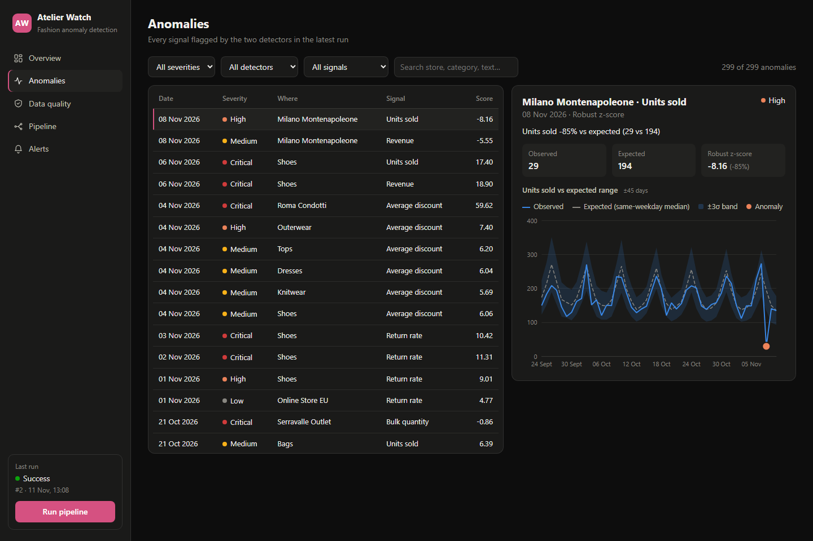
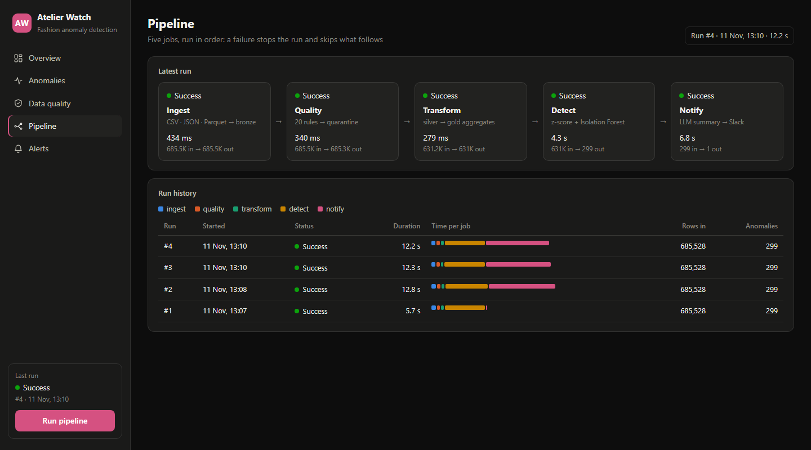
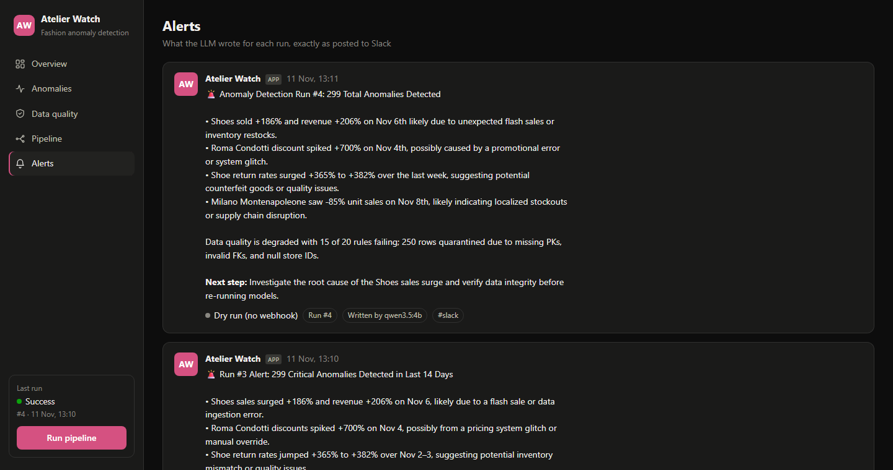

# Atelier Watch — Fashion Anomaly Detection

An end-to-end anomaly detection platform for fashion retail data: a custom ETL with a
quality gate, two complementary detectors, an LLM that turns the findings into a Slack
alert, and a dashboard to explore everything.



## What it does



| Layer | Tech | Notes |
|---|---|---|
| Storage | DuckDB (single file) | reads CSV, JSON and Parquet natively; the ETL is mostly SQL |
| ETL | 5 Python jobs run in order | every job logs status, duration and rows in/out to `job_runs`; a failure skips the rest |
| Data quality | 20 declarative SQL rules | `error` rows are quarantined with their payload, `warn` rows pass through |
| Detection | robust z-score + Isolation Forest | scored against seeded ground truth |
| Alerting | any OpenAI-compatible LLM (Groq, Ollama) → Slack webhook | template fallback and dry run when not configured |
| UI | FastAPI + vanilla JS + ECharts | no build step |

## Quick start

```bash
python -m venv .venv
.venv/Scripts/pip install -e ".[dev]"        # macOS/Linux: .venv/bin/pip
.venv/Scripts/python -m fashion_ad.pipeline generate   # synthetic data -> data/raw
.venv/Scripts/python -m fashion_ad.pipeline run        # run the 5 jobs
.venv/Scripts/python -m fashion_ad.pipeline serve      # dashboard on http://127.0.0.1:8000
```

The pipeline can also be triggered from the dashboard ("Run pipeline"). While the server is
running it holds the DuckDB file, so use the button rather than the CLI.

Optional: copy `.env.example` to `.env` to enable the LLM (Groq key, or a local Ollama model)
and the Slack webhook. With nothing configured the alert is written from a template and
stored as a dry run, so the whole demo works offline.

## The data

`generate` builds about 18 months of sales for 10 stores and 300 products (~630k sale
lines) with weekly and yearly seasonality, then deliberately damages it in two ways:

- **Dirty rows** for the quality gate: duplicate keys, missing or unknown foreign keys,
  negative quantities, impossible discounts, invalid sizes, future dates, negative stock.
- **Business anomalies**, labelled in `injected_anomalies.csv` and used only to score the
  detectors: store outages, category demand spikes, misconfigured promotions, return
  surges, price typos, bulk orders, off-hours sales.

## Data integrity and quality

Rules live in [`rules.py`](src/fashion_ad/rules.py) as plain SQL predicates, evaluated on
the bronze layer. Integrity rules cover primary-key uniqueness, NOT NULL and foreign keys;
quality rules cover value ranges, allowed sets, future dates, freshness and daily volume.



## Detection

| Detector | Input | How | Catches |
|---|---|---|---|
| Robust z-score | daily revenue, units, average discount and return rate per store and per category | expected value = median of the same weekday over the previous 10 weeks; spread = MAD of the relative residuals over the same window; flag when \|z\| ≥ 4.5 | outages, demand spikes, promo errors, return surges |
| Isolation Forest | every sale | features: deviation of the unit price from list price × discount, quantity, hours outside opening time | price typos, bulk orders, off-hours sales |

On the seeded dataset the detectors recover **100% of the injected anomalies at 75%
precision**. Matching is strict (same sale, or same entity and day), so most "false
positives" are real side effects of a seeded event — for example a store-wide promo error
also lifts the average discount of each category that day.



## Pipeline and alerts



The `notify` job sends the most severe anomalies of the last 14 days plus the data quality
summary to the LLM and posts the result to Slack.



## Tests

```bash
.venv/Scripts/python -m pytest
```

One end-to-end test module: the rules catch exactly the seeded dirty rows, nothing dirty
reaches silver, the detectors meet a minimum recall and precision, and the alert falls back
to the template without network access.

## Limitations

- The data is synthetic and the anomalies are large by design; thresholds would need tuning on real data.
- Each run reprocesses the full history (no incremental loads) and there is no scheduler.
- The dashboard has no authentication and binds to localhost only.
